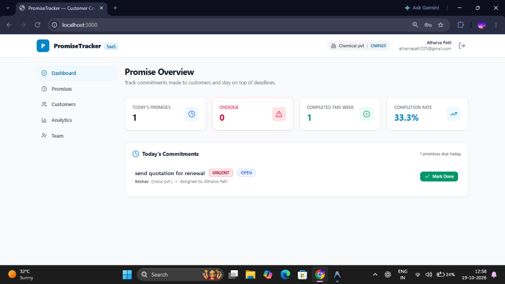
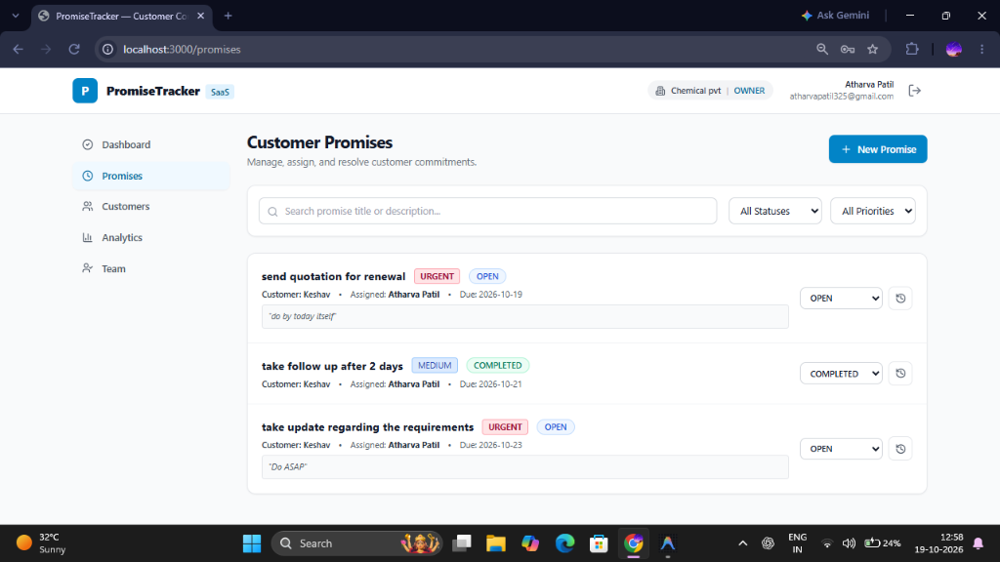
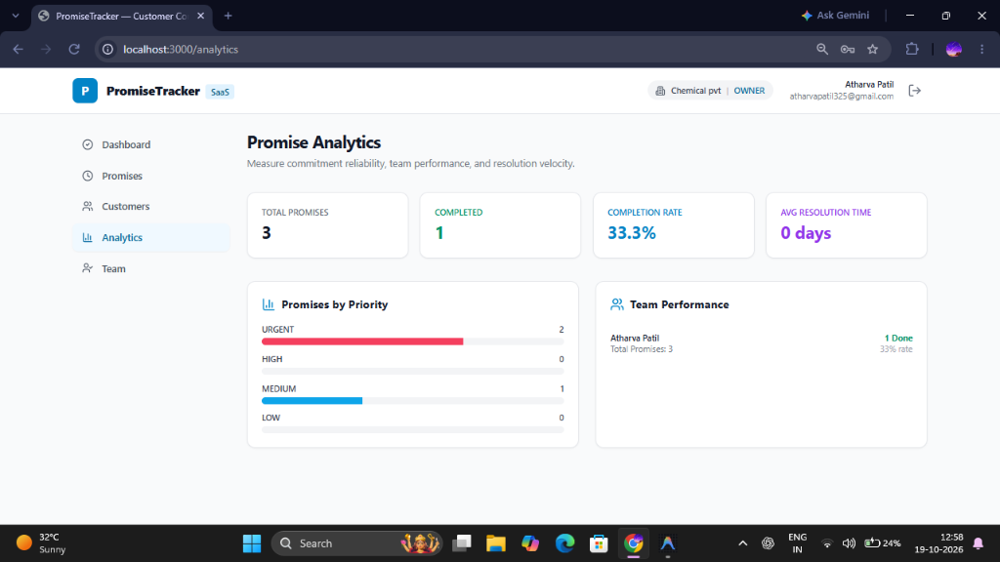

<div align="center">

# 🤝 PromiseTracker

### **Production-Grade Customer Commitment & Follow-up SaaS**

*Never forget a commitment, deadline, or promise made to a customer.*

[](https://www.oracle.com/java/)
[](https://spring.io/projects/spring-boot)
[](https://react.dev/)
[](https://www.typescriptlang.org/)
[](https://www.postgresql.org/)
[](https://tailwindcss.com/)
[](LICENSE)

</div>

---

## 📖 Overview

In fast-paced sales, customer support, and account management, critical customer commitments often fall through the cracks—hidden in unread emails, chat threads, or meeting notes.

**PromiseTracker** is a multi-tenant micro-SaaS engineered to capture, delegate, and fulfill customer promises before they become broken commitments. With strict tenant isolation, role-based security, context-aware Chrome clipping, and actionable velocity metrics, teams maintain accountability and boost customer trust.

---

## 📸 Product Walkthrough

### 1. Promise Overview & Daily Operations Dashboard
Real-time KPI overview showing today's commitments, overdue items, completion rate, and fast "Mark Done" resolution actions.



---

### 2. Customer Promises & Commitment Lifecycle
Granular list of customer promises with status tracking (`OPEN`, `IN_PROGRESS`, `COMPLETED`, `CANCELLED`), priority tags (`URGENT`, `HIGH`, `MEDIUM`, `LOW`), linked client accounts, and inline status updates with audit trail history.



---

### 3. Real-Time Team Analytics & Velocity
Actionable analytics revealing overall completion percentage, promises categorized by priority severity, average resolution turnaround, and individual team member performance.



---

## 🌟 Key Features

- **🎯 Commitment Lifecycle Tracking**: Log promises, attach original verbatim quotes ("do by today itself"), assign owners, and track due dates.
- **🏢 Multi-Tenant Architecture**: Strict organizational data isolation enforced at the database query and service layer.
- **🛡️ Role-Based Access Control (RBAC)**: Method-level Spring Security enforcing permissions across `OWNER`, `ADMIN`, and `MEMBER` roles.
- **🧩 Manifest V3 Chrome Extension**: Highlight text in webmail (Gmail, Outlook), CRM tools, or support chats to instantly record promises via browser context menu.
- **📜 Comprehensive Audit Log**: Every creation, status change, reassignment, and cancellation is captured with user timestamps for full accountability.
- **⚡ In-Memory Dev or Cloud Postgres/Supabase**: Seamlessly runs with zero-config embedded H2 for instant local development, or switches to production-grade Supabase / PostgreSQL.

---

## 🛠 Tech Stack

| Layer | Technologies |
|---|---|
| **Backend API** | Java 21, Spring Boot 3.4.1, Spring Security (JWT + BCrypt), Spring Data JPA, Hibernate, Flyway Migrations, Lombok, OpenAPI 3 / Swagger |
| **Frontend** | React 18, TypeScript, Vite, React Router 6, TanStack Query v5, Axios, Tailwind CSS, Lucide Icons |
| **Chrome Extension** | Manifest V3, TypeScript, Vite, Chrome Storage & Context Menus API |
| **Database** | Embedded H2 (Development) / PostgreSQL 16+ & Supabase (Production) |
| **DevOps / Infra** | Docker, Docker Compose, Flyway DB Migrations |

---

## 📁 Repository Structure

```text
promisetracker/
├── backend/                  # Spring Boot 3 REST API & Security
│   ├── src/main/java/        # Application code (DDD modular packages)
│   ├── src/main/resources/   # App configs & Flyway database migrations
│   ├── pom.xml               # Maven dependencies and build setup
│   └── Dockerfile            # Container build for backend
├── frontend/                 # React 18 + TypeScript SPA
│   ├── src/                  # Components, Pages, Context, API client
│   ├── package.json          # Dependencies & scripts
│   └── vite.config.ts        # Vite build & proxy settings
├── extension/                # Manifest V3 Chrome Extension
│   ├── src/                  # Background service worker & popup UI
│   └── manifest.json         # Extension configuration
├── docs/                     # Documentation & Media Assets
│   ├── screenshots/          # High-resolution application previews
│   └── security-threat-model.md
├── docker-compose.yml        # Multi-container orchestration
├── start-project.ps1         # One-click startup script (PowerShell)
├── .env.example              # Environment variables template
└── README.md
```

---

## 🚀 Quick Start Guide

### Prerequisites
- **Java 21+** (`java -version`)
- **Maven 3.9+** (`mvn -version`)
- **Node.js 20+** & **npm** (`node -v`)

---

### 1. Backend Setup

#### Mode A: Quickstart with Embedded H2 (Zero External DB Setup)
The backend defaults to the `dev` profile using an in-memory H2 database with demo data pre-seeded.

```powershell
cd backend
mvn spring-boot:run
```
- API Base URL: `http://localhost:8080`
- Swagger UI Docs: `http://localhost:8080/api/v1/swagger-ui/index.html`
- H2 Web Console: `http://localhost:8080/h2-console` *(JDBC URL: `jdbc:h2:mem:promisetracker`, user: `sa`, blank password)*

---

#### Mode B: Production with Supabase / PostgreSQL
Create a `.env` file in the root folder (or `backend/.env`):

```ini
SPRING_PROFILES_ACTIVE=prod

# Supabase Connection Pooler (IPv4)
DATABASE_URL=jdbc:postgresql://aws-0-ap-south-1.pooler.supabase.com:5432/postgres?sslmode=require
DATABASE_USERNAME=postgres.YOUR_PROJECT_REF
DATABASE_PASSWORD=your_database_password

# Authentication
JWT_SECRET=9a8b7c6d5e4f3a2b1c0d9e8f7a6b5c4d3e2f1a0b9c8d7e6f5a4b3c2d1e0f9a8b
```

Then run:
```powershell
mvn spring-boot:run
```
Flyway automatically creates and baselines all required schemas and tables.

---

### 2. Frontend Setup

In a new terminal window:

```powershell
cd frontend
npm install
npm run dev
```

Open your browser to: **`http://localhost:3000`** (or `http://localhost:5173`).

---

### 3. Demo Credentials

The application initializes with an admin owner account ready for testing:

| Field | Value |
|---|---|
| **Email** | `vedantpatil0692004@gmail.com` |
| **Password** | `692004` |
| **Role** | `OWNER` / Admin |
| **Organization** | `Acme Sales Corp` |

*(You can also click **Register** on the login page to create an entirely new tenant organization).*

---

### 4. Chrome Extension (Manifest V3)

1. Build the extension package:
   ```powershell
   cd extension
   npm install
   npm run build
   ```
2. In Google Chrome, navigate to `chrome://extensions/`.
3. Toggle on **Developer mode** in the top right.
4. Click **Load unpacked** and select the `extension/dist` folder.
5. Highlight any text on any webpage $\rightarrow$ right-click $\rightarrow$ **"Create Promise in PromiseTracker"**.

---

### 5. Docker Deployment

To spin up PostgreSQL, the Spring Boot Backend, and the React Frontend simultaneously:

```bash
docker compose up -d --build
```

---

## 🔒 Security & Architecture

PromiseTracker implements defense-in-depth principles:
- **Tenant Isolation (BOLA / IDOR Prevention)**: Queries are parameterized and scoped strictly to `organization_id` derived from the validated JWT token.
- **Strong Secret Management**: Passwords hashed using BCrypt (cost factor 12); JWT signed using HMAC-SHA256 with minimum 256-bit secrets.
- **Clean DTO Boundaries**: Database entity objects are never directly exposed over the wire; all inputs are validated with Bean Validation (`@Valid`).

For a deep dive into threat mitigations, see [`docs/security-threat-model.md`](docs/security-threat-model.md).

---

## 📜 License

Distributed under the MIT License. See [LICENSE](LICENSE) for more details.